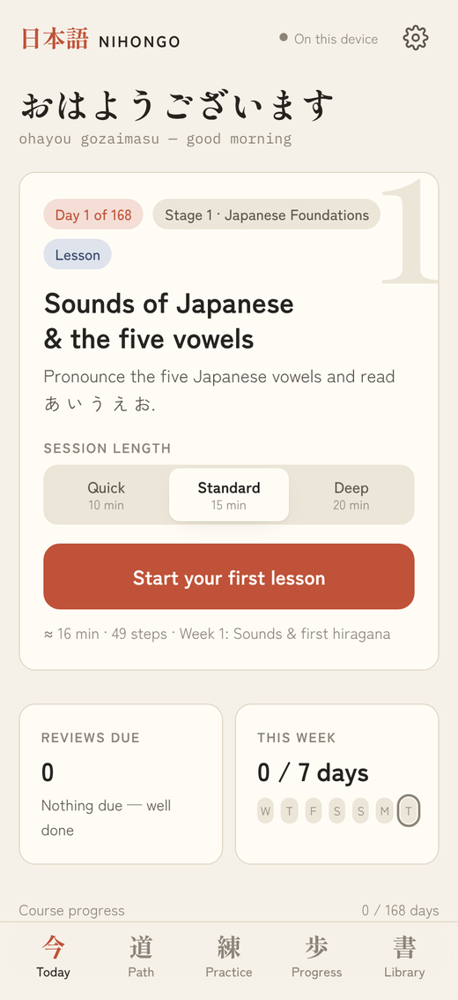
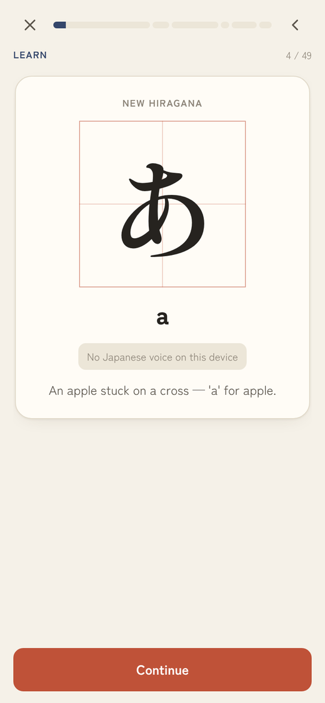
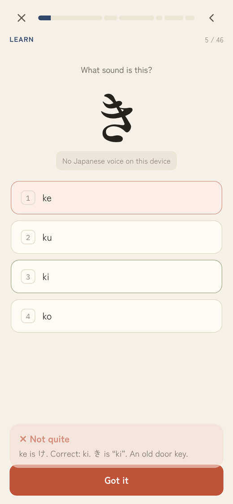
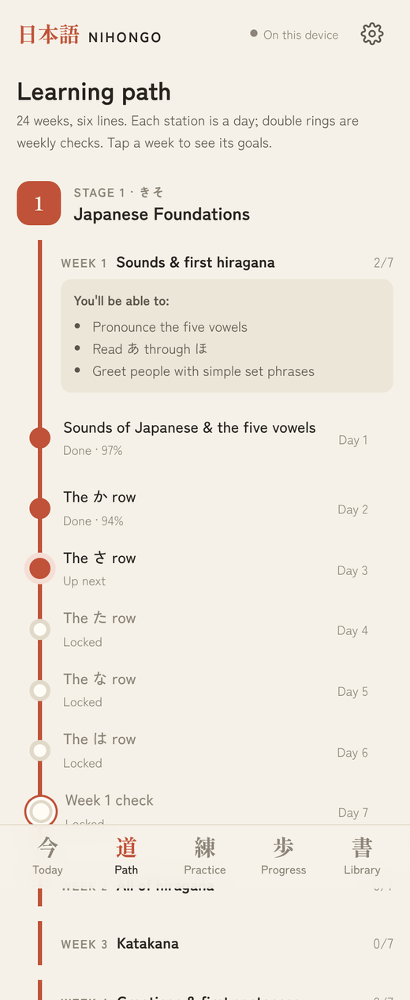
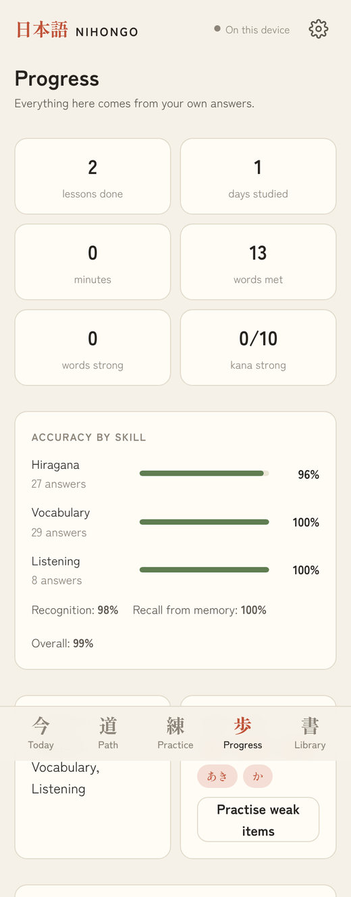
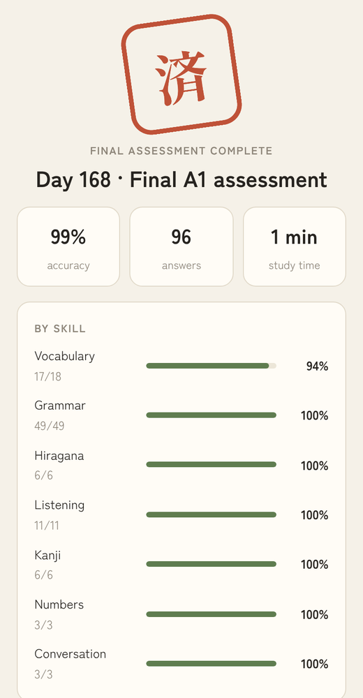

# 日本語 NIHONGO

**A complete Japanese course from absolute zero to CEFR A1, in 15 minutes a day.**

168 days, six stages and one focused skill per day. NIHONGO is a single static web app: no build step, no server, no accounts and no API keys. Open it and start Day 1.

[](https://github.com/dani-aisystems/nihongo/actions/workflows/test.yml)


<p align="center">
  
  
  
</p>

## Features

**Curriculum**
- 168 days over 24 weeks in six stages: Foundations (kana and greetings) → Simple Sentences → Everyday Communication → Practical Situations → Personal Expression → A1 Consolidation.
- Built on CEFR A1 and Japan Foundation JF Standard can-do goals, which are not the same as JLPT N5 exam prep.
- The first 14 days are hand-curated. Hiragana comes first, then katakana, with spoken phrases from Day 1. Romaji support fades after Day 28, and kanji arrive gradually with furigana.
- Every 7th day is a check that reports by skill. Days 28, 56, 84, 112 and 140 are stage assessments. Day 168 is a final assessment that produces an A1 profile and an improvement plan.

**Daily sessions**
- Each day runs Learn → Listen → Practice → Apply → Recall → Challenge.
- **Quick** (10 min), **Standard** (15 min) and **Deep** (20 min) give different workloads, not just different labels.
- Lessons resume where you left off, and you can step back to reread without losing answers.

**13 exercise types**
- Flashcards, multiple choice, kana recognition (both directions), matching, sentence building, translation, Japanese production with live romaji-to-kana input, listening, speaking self-checks, branching dialogues, error correction, and reading and listening passages.
- Answer checking accepts equivalent answers: English is normalized, small typos are allowed, and は/へ/を are accepted when spelled phonetically.

**Memory**
- Spaced repetition per kana, word, kanji and grammar point, tracking recognition and recall separately.
- Kana you confuse come back as targeted drills. Grammar you keep missing gets re-explained with a simpler example.
- The mistake notebook keeps explanations and lets you retry.
- Practice and wrong answer options only draw from lessons you've completed.
- No punishing streaks. A missed day never resets progress.

<p align="center">
  
  
  
</p>

## Run it

Any static file server works:

```bash
git clone https://github.com/dani-aisystems/nihongo.git
cd nihongo
python3 -m http.server 8000   # or: npm start
# open http://localhost:8000
```

To host it free with **GitHub Pages**, go to Settings → Pages → Deploy from a branch → `main` / `(root)`.

### Good to know
- **Progress** is saved in your browser's localStorage. Use **Settings → Export backup** to move it to another device or browser.
- **Audio** uses your device's built-in Japanese text-to-speech. That's synthesized speech, not recorded native speakers. For the clearest sound, install an "Enhanced" or "Premium" Japanese voice in your system settings and the app will pick it automatically. Without a Japanese voice, listening steps show the text instead.
- **Speaking** practice uses an honest listen, repeat and self-rate loop. There's no fake speech scoring.
- **Japanese input:** type romaji in any answer box and it becomes hiragana (`nn` → ん, double consonants → っ, `-` → ー).

## Project structure

| File | Purpose |
|---|---|
| `index.html` | Page shell, design tokens and styles (light and dark themes) |
| `data-core.js` | Kana tables, look-alike groups, kanji, grammar points, stages, weeks, A1 competencies |
| `data-days-1.js` | Days 1–56 (Stages 1–2) |
| `data-days-2.js` | Days 57–112 (Stages 3–4) |
| `data-days-3.js` | Days 113–168 (Stages 5–6) |
| `engine.js` | Kana/romaji conversion, answer checking, spaced repetition, question and lesson generation |
| `app.js` | UI: Today, Path, Practice, Progress, Library, Settings and the lesson player |

Lesson content is pure data, kept separate from rendering. Each day lists its kana, vocabulary, sentences, grammar, dialogues and reading or listening passages, and the engine turns that into a session for the chosen mode.

## Tests

```bash
npm test          # data integrity, every lesson in every mode, practice scope
npm run test:e2e  # end-to-end browser flows (needs: pip install playwright)
```

The browser suite covers a new learner finishing Day 1, a returning learner, a wrong answer with retry and notebook entry, path navigation up to Day 168, changing session length, the full final assessment, mobile layout with no sideways scroll, and runtime errors. GitHub Actions runs both suites on every push.

## Contributing

Corrections to the Japanese are especially welcome. Please open an issue or pull request with the day number and the suggested fix. Run `npm test` before submitting.

## License

[MIT](LICENSE) © 2026 Daniel Yanchev
